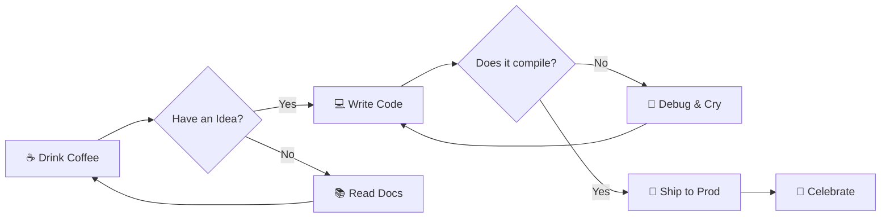

[interactive_github_readme_template.md](https://github.com/user-attachments/files/34985222/interactive_github_readme_template.md)
<div align="center">

<!-- Animated Typing SVG Banner -->
<a href="https://git.io/typing-svg">
  
</a>

<p align="center">
  <a href="#-about-me">About</a> •
  <a href="#-tech-stack">Tech Stack</a> •
  <a href="#-architecture-playground">Diagrams</a> •
  <a href="#-interactive-faq">FAQ</a>
</p>

<!-- Interactive Shields.io Badges -->
[](https://yourwebsite.com)
[](https://linkedin.com/in/yourprofile)
[](https://x.com/yourhandle)
[](https://buymeacoffee.com/yourhandle)

</div>

---

<!-- GitHub Native Alert Callouts -->
> [!TIP]
> **Welcome, traveler!** Everything on this page is rendered purely using GitHub-Flavored Markdown, native HTML tags, and dynamic SVGs—zero external JavaScript required.

## 🚀 About Me & Live Metrics

<!-- Side-by-Side Layout using Borderless HTML Table -->
<table>
  <tr>
    <td width="50%" valign="top">
      <h3>👋 Hey there!</h3>
      <p>I'm a developer who loves pushing tools to their limits, automating repetitive tasks, and crafting clean, resilient software.</p>
      <ul>
        <li>🔭 <b>Currently building:</b> Next-gen developer tools</li>
        <li>🌱 <b>Currently learning:</b> Rust, WebAssembly & Distributed Systems</li>
        <li>👯 <b>Looking to collaborate on:</b> Fun open-source CLI utilities</li>
        <li>⚡ <b>Fun fact:</b> I can explain recursion using only a mirror and a webcam</li>
      </ul>
    </td>
    <td width="50%" valign="top" align="center">
      <h3>📊 GitHub Telemetry</h3>
      <!-- Replace 'torvalds' with your actual GitHub username! -->
      
      <br/>
      
    </td>
  </tr>
</table>

---

## 🛠️ Tech Stack

<div align="center">
  
</div>

---

## 🧠 Architecture Playground (Native Mermaid Diagrams)

GitHub natively renders **Mermaid.js** diagrams directly inside Markdown code blocks! Here is a live flowchart representing my daily workflow:



---

## 💻 Code & Diff Highlighting

Markdown supports rich syntax highlighting—including `diff` blocks to show code changes visually:

```diff
function deployToProduction(code) {
-   // YOLO push directly to main on a Friday at 5 PM
-   git.push('origin', 'main', { force: true });
+   // Run full test suite and staged rollout
+   if (tests.runAll() === 'PASS') {
+       ci.deployWithCanary(code);
+   }
}
```

---

## 🎛️ Interactive FAQ & Easter Eggs

Click any of the sections below to expand hidden content using native `<details>` accordions:

<details>
  <summary><b>🎮 Click to reveal my current side quests (Task List)</b></summary>
  <br/>

  - [x] Build a ridiculously over-engineered GitHub README
  - [x] Drink 3 cups of coffee before noon
  - [ ] Refactor that one legacy file everyone is afraid to touch
  - [ ] Achieve inbox zero (impossible)
</details>

<details>
  <summary><b>📐 Click to see native LaTeX Math Rendering</b></summary>
  <br/>

  GitHub renders mathematical expressions natively using `$` and `$$`! For example, here is the famous Euler's identity and the quadratic formula:

  $$e^{i\pi} + 1 = 0$$

  $$x = \frac{-b \pm \sqrt{b^2 - 4ac}}{2a}$$
</details>

<details>
  <summary><b>⌨️ Click for Keyboard Shortcut Styling</b></summary>
  <br/>

  You can render realistic keyboard keys using the `<kbd>` tag:
  
  Press <kbd>Ctrl</kbd> + <kbd>C</kbd> to copy, or <kbd>⌘</kbd> + <kbd>Shift</kbd> + <kbd>P</kbd> to open the Command Palette!
</details>

---

> [!NOTE]
> **Want to customize this?** Swap out `torvalds` in the stats image URLs with your own GitHub username, update the social links at the top, and commit this file as `README.md` in a repository named after your username (`your-username/your-username`).

<div align="center">
  
</div>
